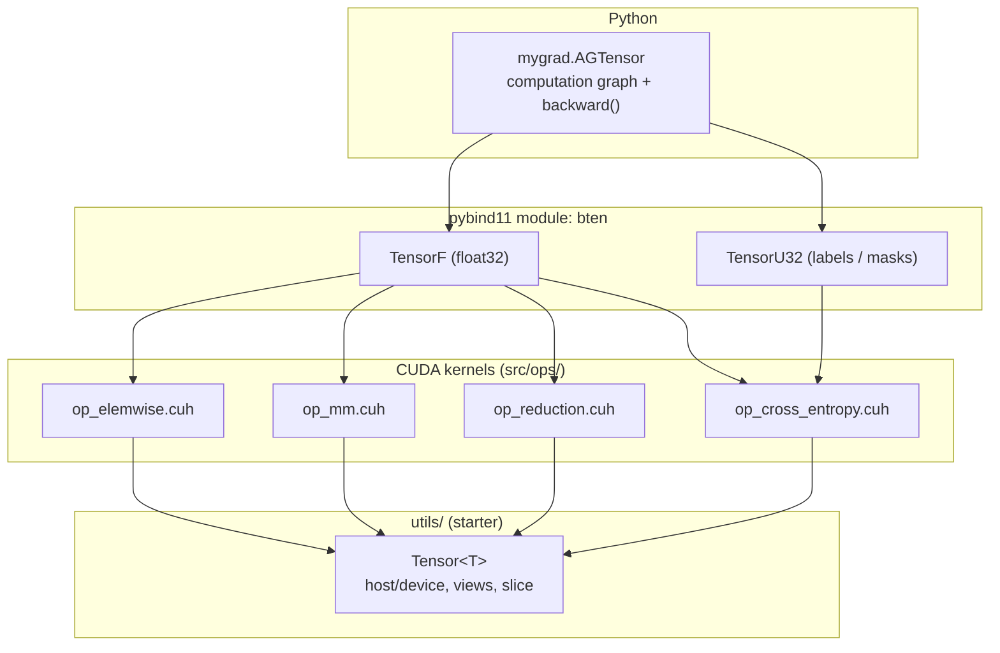

<p align="center">
  <strong>BareNet</strong> — a minimal CUDA tensor library with Python autograd
</p>

<p align="center">
  <a href="#quick-start">Quick start</a> ·
  <a href="#architecture">Architecture</a> ·
  <a href="#api-reference">API</a> ·
  <a href="#examples">Examples</a> ·
  <a href="#project-structure">Structure</a>
</p>

> **Credit:** BareNet was built as an NYU team project. This is a fork of the team repository, [dq2024/baranet-bdml](https://github.com/dq2024/baranet-bdml), and builds on the course's starter code (see the note below).

---

**BareNet** (`baranet-bdml`) is a from-scratch deep-learning stack: a **C++/CUDA** tensor runtime exposed to Python via **pybind11**, plus a small **reverse-mode autograd** engine in pure Python. It is designed for learning how frameworks like PyTorch are built—memory layout, GPU kernels, broadcasting, reductions, and backprop—without hiding the details behind a black box.

| Layer | Role |
|-------|------|
| **`bten`** | Fast 2D tensors (`float32`, `uint32`) on CPU or CUDA |
| **`mygrad`** | `AGTensor` wrapper: computation graph + `backward()` |
| **`src/ops/`** | CUDA kernels for elemwise, matmul, sum/argmax, cross-entropy |

> **Note:** This repository expects a `utils/` directory (`tensor.cuh`, `check_error.cuh`, etc.) that ships with the course starter code. If `utils/` is missing, clone the full starter or copy those headers before building.

---

## Table of contents

- [Features](#features)
- [Requirements](#requirements)
- [Quick start](#quick-start)
- [Architecture](#architecture)
- [Project structure](#project-structure)
- [Building from source](#building-from-source)
- [API reference](#api-reference)
  - [Low-level: `bten`](#low-level-bten)
  - [High-level: `mygrad.AGTensor`](#high-level-mygradagtensor)
- [Examples](#examples)
- [How autograd works](#how-autograd-works)
- [CUDA operations](#cuda-operations)
- [Lab assignments](#lab-assignments)
- [Limitations](#limitations)
- [Upstream](#upstream)

---

## Features

- **2D tensors** on GPU or CPU with explicit device placement (`is_cuda=True/False`)
- **Elementwise ops** with broadcasting: `+`, `-`, `*`, `==`, ReLU (+ backward)
- **Matrix multiply** (`@`) with a tiled CUDA kernel
- **Reductions**: row/column `sum`, per-row `argmax`
- **Cross-entropy loss** with numerically stable softmax (log-sum-exp) and fused gradient
- **Python autograd** (`AGTensor`): topological-sort backprop, `no_grad()` context manager
- **NumPy interop**: `copy_from_numpy` / `to_numpy` for debugging and data loading

---

## Requirements

| Dependency | Version / notes |
|------------|-----------------|
| **OS** | Linux recommended; macOS may work with CUDA where available |
| **CMake** | ≥ 3.20 |
| **C++ compiler** | C++17 |
| **CUDA Toolkit** | With `nvcc`, `cudart`, **cuRAND** |
| **Python** | 3.8+ with development headers |
| **pybind11** | Fetched automatically by CMake if not installed |
| **NumPy** | Used by `mygrad` and for I/O |

**GPU architectures** targeted by CMake (standalone `.cu` executables): `sm_70`, `75`, `80`, `86`, `89`. Adjust `CUDA_ARCHITECTURES` in `CMakeLists.txt` if your GPU is different.

---

## Quick start

```bash
# 1. Clone (ensure utils/ is present — see note above)
git clone https://github.com/rijuld/baranet-bdml.git
cd baranet-bdml

# 2. Configure and build the Python extension
cmake -S . -B build -DCMAKE_BUILD_TYPE=Release
cmake --build build -j

# 3. Smoke test from Python (build/ must be on sys.path — engine.py does this)
python3 -c "
import sys; sys.path.insert(0, 'build')
import bten
import numpy as np

x = bten.TensorF(2, 3, True)
x.copy_from_numpy(np.arange(6, dtype=np.float32).reshape(2, 3))
y = x + x
print(y.to_numpy())
"
```

Train-style usage with autograd:

```python
import sys; sys.path.insert(0, "build")
import numpy as np
from mygrad.engine import AGTensor

W = AGTensor(np.random.randn(4, 3).astype(np.float32) * 0.1)
x = AGTensor(np.random.randn(2, 4).astype(np.float32))
logits = (x @ W).relu()
loss = logits.mean()
loss.backward()
print(W.grad.numpy())  # gradient w.r.t. W
```

---

## Architecture



**Data flow**

1. You create an `AGTensor` from NumPy or a `bten` tensor.
2. Each op builds a new `AGTensor` and registers a `_backward` closure.
3. Calling `backward()` on a scalar loss walks the graph in reverse topological order and accumulates `.grad` on leaves.

Forward passes always go through CUDA (when `is_cuda=True`); gradients are also `bten.TensorF` objects, not NumPy arrays.

---

## Project structure

```
baranet-bdml/
├── CMakeLists.txt          # Builds pybind module `bten` + optional .cu binaries
├── README.md
├── mygrad/
│   ├── __init__.py
│   └── engine.py           # AGTensor autograd engine
├── src/
│   ├── bindings.cu         # PYBIND11_MODULE(bten, …)
│   ├── py_tensor_shim.hh   # PyTensor wrapper + Python operators
│   └── ops/
│       ├── op_elemwise.cuh # +, -, *, ==, ReLU, fill, uniform
│       ├── op_mm.cuh       # matrix multiply
│       ├── op_reduction.cuh# sum, argmax
│       └── op_cross_entropy.cuh
└── utils/                  # ← required starter headers (not always in this snapshot)
    ├── tensor.cuh
    └── check_error.cuh
```

---

## Building from source

```bash
cmake -S . -B build \
  -DCMAKE_BUILD_TYPE=Release \
  -DPython3_EXECUTABLE=$(which python3)

cmake --build build -j$(nproc)
```

**Outputs**

| Artifact | Description |
|----------|-------------|
| `build/bten*.so` | Import as `import bten` (add `build/` to `PYTHONPATH`) |
| Other `src/*.cu` binaries | Optional standalone CUDA programs (excluding `bindings.cu`) |

**Debug build** (device-side symbols):

```bash
cmake -S . -B build-debug -DCMAKE_BUILD_TYPE=Debug
cmake --build build-debug -j
```

**Common build issues**

| Symptom | Fix |
|---------|-----|
| `utils/tensor.cuh: No such file` | Add the course `utils/` folder to the project root |
| `CUDAToolkit not found` | Install CUDA toolkit; set `CUDACXX` / `PATH` |
| Wrong GPU arch | Edit `CUDA_ARCHITECTURES` in `CMakeLists.txt` |
| `import bten` fails | Ensure `build/` is on `sys.path` (see `engine.py`) |

---

## API reference

### Low-level: `bten`

Import after building:

```python
import sys; sys.path.insert(0, "build")
import bten
```

#### `bten.TensorF` / `bten.TensorU32`

| Member / method | Description |
|-----------------|-------------|
| `TensorF(h, w, is_cuda=True)` | Allocate `(h, w)` tensor |
| `.shape` | `(height, width)` |
| `.is_cuda` | Device flag |
| `.fill(value)` | Constant init |
| `.to_numpy()` | Copy to host NumPy array |
| `.copy_from_numpy(arr)` | Host → device (or host) copy; shape must match |
| `.transpose()` / `.T` | Non-copy transpose **view** |
| `[row_slice, col_slice]` | 2D indexing (int, slice, `None`, `...`) |
| `a + b`, `a - b`, `a * b` | Broadcast elemwise (see below) |
| `a + scalar`, `a * scalar` | Unary-with-constant overloads |
| `a @ b` | Matrix multiply: `(M×K) @ (K×N) → (M×N)` |
| `a == b` | Elementwise equality → `TensorU32` (0/1) |
| `.relu()` | `max(0, x)` |
| `.relu_back(d_out)` | ReLU backward given upstream grad |
| `.sum(axis=0\|1)` | Reduce rows (`axis=0` → shape `(1, w)`) or cols (`axis=1` → `(h, 1)`) |
| `.argmax()` | Per-row argmax → `(h, 1)` `TensorU32` |
| `.cross_entropy_loss(labels, d_logits)` | Scalar mean CE + writes ∂L/∂logits into `d_logits` |

**Broadcasting rules** (elemwise binary): the second operand may have `h == 1` or `w == 1`; its values are replicated along the singleton dimension. Examples:

```
[[1,2,3],     +  [[10],     →  [[11,12,13],
 [4,5,6]]          [20]]         [24,25,26]]

[[1,2,3],     +  [[10,20,30]] →  [[11,22,33],
 [4,5,6]]                          [14,25,36]]
```

---

### High-level: `mygrad.AGTensor`

```python
from mygrad.engine import AGTensor, no_grad, is_grad_enabled
```

#### Construction

```python
AGTensor(data, children=(), op='', requires_grad=True, is_cuda=None)
```

| Argument | Meaning |
|----------|---------|
| `data` | `np.ndarray`, `bten.TensorF`, or `bten.TensorU32` |
| `children` | Parent nodes in the computation graph |
| `requires_grad` | If `False`, node is excluded from backward |
| `is_cuda` | When wrapping NumPy, choose device (default: `True`) |

#### Differentiable ops

| Op | Notes |
|----|-------|
| `a + b`, `a - b`, `a * b` | Scalars or tensors; broadcast grad via `.sum(axis=…)` |
| `a @ b` | Matmul; grad: `dOut @ b.T`, `a.T @ dOut` |
| `.T` | Transpose |
| `.relu()` | Uses `bten` forward + `relu_back` |
| `.sum(axis=None)` | `None` → global sum to `(1,1)`; `0/1` → keepdims reduction |
| `.mean()` | `sum() / numel` |
| `.cross_entropy_loss(targets)` | `targets`: NumPy integer labels `(N,)` or `(N,1)` |

#### Non-differentiable

| Op | Notes |
|----|-------|
| `.argmax()` | Per-row class index |
| `a == b` | `b` may be `AGTensor` or NumPy; returns 0/1 tensor |

#### Backprop

```python
loss.backward()          # loss must be scalar (1×1); grad defaults to ones
loss.backward(grad=...)  # optional upstream gradient tensor
```

```python
with no_grad():
    y = model(x)  # inference without building grad closures
```

#### Debugging

```python
t.numpy()    # same as t.data.to_numpy()
repr(t)      # Tensor(shape=..., device=cuda|cpu, op='relu')
```

---

## Examples

### Matrix multiply + ReLU

```python
import sys; sys.path.insert(0, "build")
import numpy as np
from mygrad.engine import AGTensor

A = AGTensor(np.array([[1., 2.], [3., 4.]], dtype=np.float32))
B = AGTensor(np.array([[0.5, 1.0], [1.5, 2.0]], dtype=np.float32))
C = (A @ B).relu()
loss = C.sum()
loss.backward()
print("dA:\n", A.grad.numpy())
print("dB:\n", B.grad.numpy())
```

### Classification loss

```python
import sys; sys.path.insert(0, "build")
import numpy as np
from mygrad.engine import AGTensor

# Batch of 3 samples, 4 classes
logits = AGTensor(np.random.randn(3, 4).astype(np.float32) * 0.1)
targets = np.array([1, 0, 3], dtype=np.uint32)

loss = logits.cross_entropy_loss(targets)
loss.backward()
print("loss:", loss.numpy())
print("d_logits:\n", logits.grad.numpy())
```

### CPU tensors (no GPU)

```python
x = AGTensor(np.ones((2, 2), dtype=np.float32), is_cuda=False)
y = (x * 2).sum()
y.backward()
```

---

## How autograd works

BareNet uses **reverse-mode automatic differentiation** (like PyTorch), implemented explicitly rather than via operator overloading magic:

1. **Forward**: Each op returns a new `AGTensor` and stores:
   - `_prev`: parent nodes
   - `_backward`: a closure that writes gradients into parents
   - `_op`: string tag for debugging (`'@'`, `'relu'`, …)

2. **Backward**: `backward()` on the loss node:
   - Topologically sorts all nodes with `requires_grad=True`
   - Sets `loss.grad` to ones (or a provided seed)
   - Visits nodes in reverse order, calling each `_backward()`
   - Accumulates gradients with `+=` when a tensor is used multiple times

3. **Gradient tensors** are `bten.TensorF` on the same device as the forward tensor—no automatic CPU fallback.

`is_grad_enabled()` / `no_grad()` mirror PyTorch’s autograd guard for inference.

---

## CUDA operations

| File | Kernels / helpers | Block size |
|------|-------------------|------------|
| `op_elemwise.cuh` | Unary/binary elemwise, broadcast, ReLU, fill, uniform (cuRAND on GPU) | 32×32 |
| `op_mm.cuh` | Naive matmul one thread per output element | 32×32 |
| `op_reduction.cuh` | Row/column sum and argmax via accumulator functors | 32×32 |
| `op_cross_entropy.cuh` | Stable softmax CE per row + ∂L/∂logits | 32 threads / row |

Each op dispatches to **GPU** or **CPU** based on `tensor.on_device`. Shape checks run on the host before launch (`ensure_*_shape_device`).

**Cross-entropy** (per row \(i\), classes \(j\)):

\[
\text{loss}_i = -\log \frac{e^{z_{i,y_i}}}{\sum_j e^{z_{ij}}}
\]

Gradients use the softmax Jacobian (implemented in `op_cross_entropy_kernel`), averaged over the batch.

---

## Lab assignments

The codebase is structured around two labs (comments in source):

| Lab | File(s) | Topics |
|-----|---------|--------|
| **Lab 1** | `src/ops/*.cuh` | CUDA functors, kernel launches, broadcasting, matmul, reductions, cross-entropy |
| **Lab 2** | `mygrad/engine.py` | `AGTensor` init, forward ops, `backward()` topological sort |

Search for `Lab-1:` and `Lab-2:` in the repo to find remaining or completed exercises.

---

## Limitations

BareNet is intentionally minimal—**not** a production ML framework:

- **2D only** — no batched N-D tensors (batch dimension = rows)
- **Dtypes** — `float32` and `uint32` only
- **No optimizer**, **no modules**, **no conv/pool**, **no saving/loading**
- **No mixed precision** or autotuned GEMM
- **Broadcasting** — limited patterns (singleton row or column on operand 2)
- **Views** — transpose/slice are views; in-place aliasing pitfalls are your responsibility
- **`utils/` dependency** — core `Tensor<T>` lives in course starter headers

For real projects, use [PyTorch](https://pytorch.org/), [JAX](https://github.com/google/jax), or [CuPy](https://cupy.dev/).

---

## Upstream

This tree tracks **[rijuld/baranet-bdml](https://github.com/rijuld/baranet-bdml)** on GitHub.

```bash
git remote -v
# origin  https://github.com/rijuld/baranet-bdml (fetch/push)
```

---

## License

No license file is included in this snapshot. Check the upstream repository or your course materials for terms of use.

---

<p align="center">
  Built to explain tensors, kernels, and autograd—not to replace them.
</p>
